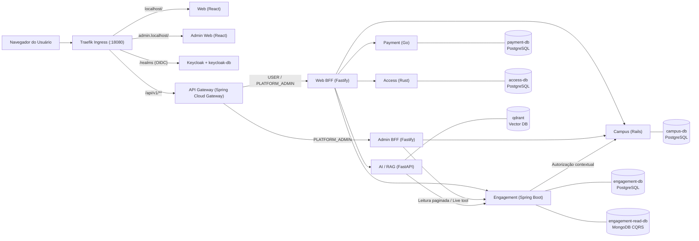
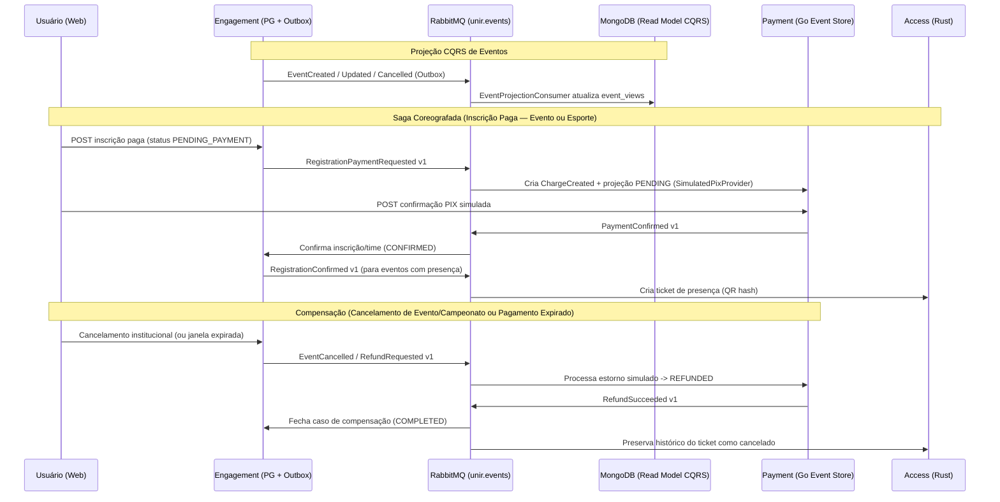
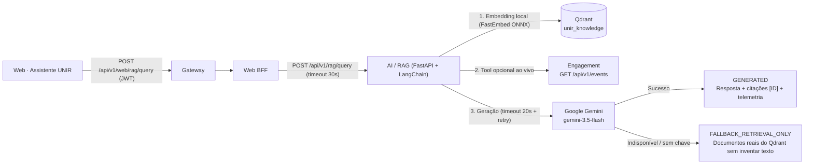

# Arquitetura da Plataforma UNIR

A UNIR é organizada como um conjunto de microsserviços independentes com **Database-per-Service**, autenticação centralizada via **Keycloak (OIDC / JWT RS256)**, entrada única via **Traefik Ingress + API Gateway + BFFs**, comunicação assíncrona confiável via **Transactional Outbox + RabbitMQ**, leitura separada de eventos via **CQRS (MongoDB)** e descoberta semântica via **RAG (Qdrant + Gemini)**.

---

## 1. Visão geral da comunicação HTTP (síncrona)

---

## 2. Comunicação assíncrona: Outbox, Saga de Pagamento/Estorno, CQRS e Tickets

Toda mudança crítica que cruza fronteiras de serviço grava o estado de negócio e o evento de integração **na mesma transação PostgreSQL** (padrão *Transactional Outbox*). Publicadores dedicados enviam as mensagens ao exchange `unir.events` no **RabbitMQ** com confirmação de roteamento, e cada consumidor faz deduplicação idempotente antes de confirmar o ACK. Veja o detalhamento completo dos fluxos felizes, falhas e compensações em **[docs/SAGA.md](SAGA.md)**.

---

## 3. Fluxo do Assistente UNIR (AI / RAG)

---

## 4. Regras e limites arquiteturais

1. **Database-per-Service estrito:** nenhum serviço acessa o banco de outro. Identificadores externos (`userId` = `sub` do Keycloak, `departmentId`, `eventId`, `registrationId`) são referências lógicas sem foreign key entre bancos.
2. **Identidade vs. Autorização contextual:**
   - **Keycloak** emite JWT RS256 com papéis globais (`USER`, `PLATFORM_ADMIN`).
   - **API Gateway** valida assinatura/validade/papel na borda e nega rotas não mapeadas (`denyAll`).
   - **Campus** é a fonte de verdade de autorização contextual (quem administra universidade, unidade, departamento, entidade, comunidade e quais professores têm afiliação `ACTIVE`). `Engagement` consulta o `Campus` com o token do usuário antes de criar/editar/cancelar recursos.
3. **BFFs sem estado e sem banco:** `web-bff` e `admin-bff` apenas adaptam/agregam chamadas para seus respectivos frontends e removem campos internos quando necessário (verificado automaticamente em `scripts/check-ts-architecture.mjs`).
4. **Limites de domínio explícitos:**
   - **Pagamentos:** `Payment` usa apenas `SimulatedPixProvider` (simulação determinística sem dinheiro real).
   - **Presença:** `Access` gerencia tickets e QR Code de **eventos**; o check-in de **partidas esportivas** pertence ao `Engagement`.
   - **CQRS:** listagens públicas de eventos leem do **MongoDB** (`event_views`); operações de escrita, gestão e inscrições leem/gravam no **PostgreSQL** do `Engagement`.
