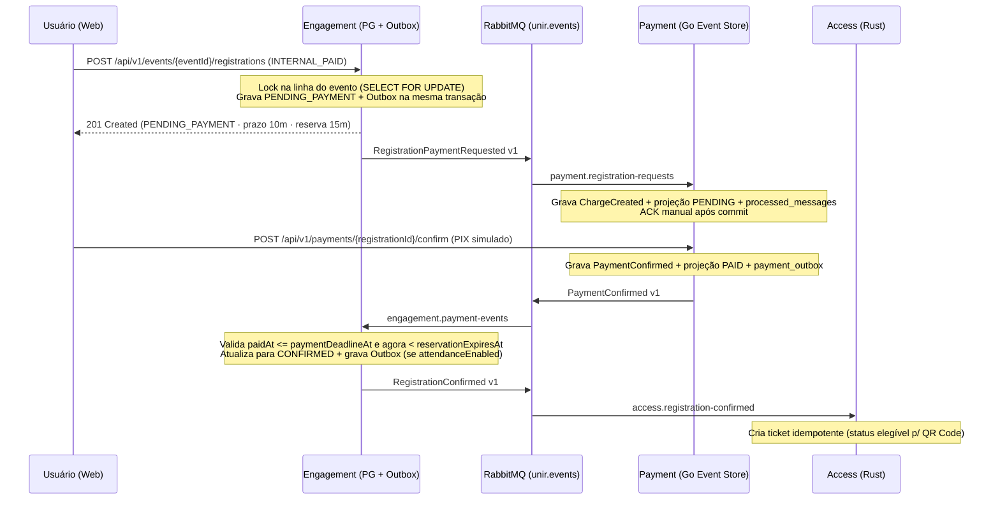
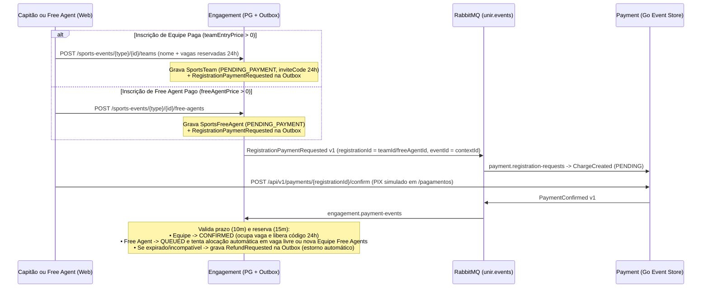
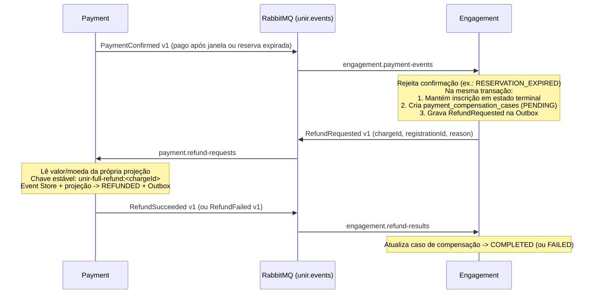
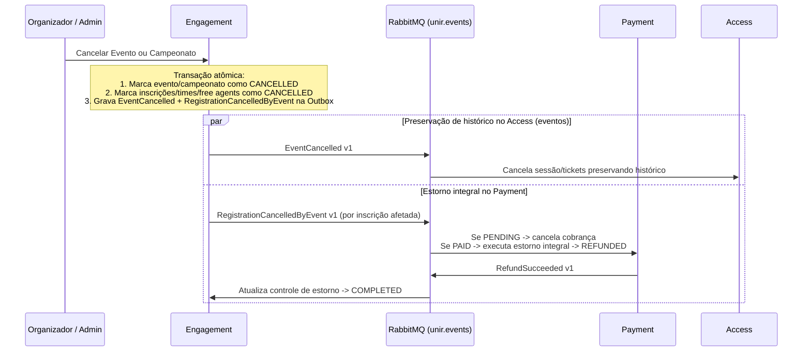

# Saga Coreografada — Pagamentos, Confirmação e Estorno Compensatório (`docs/SAGA.md`)

A UNIR adota o padrão **Database-per-Service**: `Engagement`, `Payment` e `Access` possuem bancos PostgreSQL próprios e independentes. Como não existe transação distribuída (2PC) entre microsserviços, toda operação que envolve **inscrição paga**, **cobrança PIX simulada**, **emissão de ticket** e **estorno compensatório** é coordenada por uma **Saga Coreografada** via **Transactional Outbox + RabbitMQ (`unir.events`)**.

> **Nota sobre pagamentos locais:** o `Payment` utiliza exclusivamente o adaptador `SimulatedPixProvider` (sem integração bancária real e sem movimentação financeira). Toda a mecânica distribuída (Outbox, filas duráveis, Event Store, idempotência e compensação) é real e idêntica à necessária para um provedor externo.

---

## 1. Participantes e responsabilidades

| Serviço | Papel na Saga | Persistência própria |
| --- | --- | --- |
| **Engagement** (Java / Spring Boot) | Inicia a Saga ao reservar vaga de evento pago (`INTERNAL_PAID`) ou inscrição paga de equipe/free agent em esportes; controla janelas de pagamento (10 min) e reserva (15 min); decide confirmação final, casos de compensação e cancelamento institucional. | `engagement-db` (PostgreSQL: `registrations`, `sports_teams`, `sports_free_agents`, `payment_compensation_cases`, `outbox_events`, `processed_payment_confirmations`). |
| **Payment** (Go) | Cria e gerencia cobranças via Event Store + projeção (`charge_projections`); processa confirmação simulada (`PAID`) e estorno integral (`REFUNDED`) com chave de idempotência `unir-full-refund:<chargeId>`. | `payment-db` (PostgreSQL: event store append-only, `charge_projections`, `payment_outbox`, `processed_messages`). |
| **Access** (Rust) | Emite tickets e credenciais QR para inscrições confirmadas em eventos com `attendanceEnabled = true`; preserva histórico ao receber cancelamentos individuais ou de evento. | `access-db` (PostgreSQL: sessões de eventos e tickets com hash de QR). |
| **RabbitMQ** | Broker AMQP com exchange durável `unir.events` (topic), entrega *at-least-once*, publisher confirms e ACK manual pós-commit. | `PVC/rabbitmq-data`. |

---

## 2. Mapa de eventos, routing keys e filas

| Evento (v1) | Publicador (Outbox) | Routing key (`unir.events`) | Fila consumidora | Consumidor | Contrato |
| --- | --- | --- | --- | --- | --- |
| `RegistrationPaymentRequested` | Engagement | `engagement.registration.payment-requested.v1` | `payment.registration-requests` | Payment | [contrato](contracts/registration-payment-requested-v1.md) |
| `PaymentConfirmed` | Payment | `payment.charge.confirmed.v1` | `engagement.payment-events` | Engagement | [contrato](contracts/payment-confirmed-v1.md) |
| `RegistrationConfirmed` | Engagement | `engagement.registration.confirmed.v1` | `access.registration-confirmed` | Access | [contrato](contracts/registration-confirmed-v1.md) |
| `RefundRequested` | Engagement | `engagement.payment.refund-requested.v1` | `payment.refund-requests` | Payment | [contrato](contracts/refund-flow-v1.md) |
| `EventCancelled` | Engagement | `engagement.event.cancelled.v1` | `access.registration-confirmed` | Access | [contrato](contracts/event-cancellation-v1.md) |
| `RegistrationCancelledByEvent` | Engagement | `engagement.registration.cancelled-by-event.v1` | `payment.refund-requests` / cancelamento | Payment | [contrato](contracts/event-cancellation-v1.md) |
| `RegistrationCancelled` | Engagement | `engagement.registration.cancelled.v1` | `access.registration-confirmed` | Access | [contrato](contracts/registration-cancelled-v1.md) |
| `RefundSucceeded` | Payment | `payment.refund.succeeded.v1` | `engagement.refund-results` | Engagement | [contrato](contracts/refund-flow-v1.md) |
| `RefundFailed` | Payment | `payment.refund.failed.v1` | `engagement.refund-results` | Engagement | [contrato](contracts/refund-flow-v1.md) |

---

## 3. Fluxo 1 — Caminho feliz em Eventos Pagos (Inscrição até Ticket no Access)



---

## 4. Fluxo 2 — Esportes Pagos (Equipe com Código 24h, Free Agent e Cancelamento)

Campeonatos (`COMPETITION`, 32 times) e Temporadas (`SEASON`, 10 times) com taxa configurada (`teamEntryPrice > 0` para equipe ou `freeAgentPrice > 0` para atleta avulso) reutilizam **exatamente a mesma Saga Coreografada** entre `Engagement` e `Payment`:

- No payload `RegistrationPaymentRequested`, `registrationId` carrega o UUID da entidade criada (`sports_teams.id` para equipe ou `sports_free_agents.id` para free agent) e `eventId` carrega o UUID do campeonato/temporada (`contextId`).
- **Não há envolvimento do `Access`:** o check-in das partidas esportivas pertence ao `Engagement`.



### Regras específicas da Saga em Esportes
- **Colegas entrando por código 24h (`POST .../teams/join`):** a taxa de equipe é cobrada uma única vez do capitão criador do time; os demais integrantes que entram usando o `inviteCode` dentro das 24 horas não geram cobrança duplicada.
- **Cancelamento de campeonato/temporada (`POST /api/v1/sports-events/{contextType}/{id}/cancel`):** em transação atômica, `Engagement` marca a competição/temporada e todos os times e free agents ativos/pendentes como `CANCELLED` e grava `EventCancelled` + um `RegistrationCancelledByEvent` por time e free agent afetado na Outbox — acionando o estorno integral (`REFUNDED`) no `Payment` para todas as taxas pagas.

---

## 5. Fluxo 3 — Compensação por pagamento tardio ou reserva expirada

Quando o pagamento é capturado tarde demais (`paidAt > paymentDeadlineAt`), chega após `reservationExpiresAt` ou a inscrição já está em estado terminal (`CANCELLED` / `PAYMENT_EXPIRED`), o `Engagement` **não reativa** a inscrição e inicia automaticamente a **transação compensatória de estorno**:



---

## 6. Fluxo 4 — Compensação por cancelamento institucional (Evento ou Campeonato)

Quando um organizador/admin cancela um **evento** (`DELETE /api/v1/events/{id}`) ou um **campeonato/temporada esportiva** (`POST /api/v1/sports-events/{contextType}/{id}/cancel`):



---

## 7. Garantias de consistência e resiliência

1. **Atomicidade local (Transactional Outbox):** nenhum serviço publica diretamente no RabbitMQ dentro de um request HTTP sem persistir primeiro na tabela de Outbox dentro da mesma transação PostgreSQL.
2. **Controle de concorrência de vagas:** `Engagement` serializa inscrições e cancelamentos com `SELECT FOR UPDATE` no evento e índice único parcial para impedir duplicidade ativa.
3. **Entrega confiável (*at-least-once*):** publicadores exigem *publisher confirms* roteados do RabbitMQ e retentam itens pendentes; consumidores só enviam `ACK` após commit bem-sucedido no banco.
4. **Idempotência ponta a ponta:**
   - Deduplicação por `messageId` em todos os consumidores (`processed_messages`, `processed_payment_confirmations`);
   - Deduplicação de negócio por `registrationId` (na cobrança) e por `unir-full-refund:<chargeId>` (no estorno);
   - Estados terminais irreversíveis: um `RefundFailed` atrasado nunca regride um caso já `COMPLETED`, e um `PaymentConfirmed` atrasado nunca reativa uma inscrição cancelada/expirada.
5. **Autoridade de valores no `Payment`:** no estorno, o `Engagement` nunca recalcula valores; o `Payment` reembolsa o montante integral a partir da cobrança persistida em seu próprio Event Store.

---

## 8. Como testar e observar a Saga ao vivo no Kubernetes

1. **Suba o cluster:** `make k8s-demo`
2. **(Opcional) Abra o painel do RabbitMQ em outro terminal** para acompanhar exchanges, filas e taxas de mensagens:
   ```sh
   kubectl -n unir port-forward svc/rabbitmq 15673:15672
   # Acesse http://localhost:15673 (usuário/senha: unir / unir-local-only)
   ```
3. **Pela CLI (roteiro automatizado completo — cria evento pago, inscreve, confirma PIX, valida ticket no Access, cancela evento e verifica `REFUNDED` no Payment):**
   ```sh
   make demo-saga
   ```
4. **Pela interface Web (`http://localhost:18080`):**
   - Crie um evento pago (ou campeonato pago) como `admin@gmail.com` ou professor verificado;
   - Inscreva-se como `aluno1@gmail.com`, acesse **Meus pagamentos** (`/pagamentos`) e clique em **Confirmar pagamento PIX (simulado)**;
   - Confira o ticket gerado em **Meus tickets** (`/tickets`);
   - Cancele o evento ou campeonato como organizador/admin e verifique a cobrança passar automaticamente para **`REFUNDED`** em **Meus pagamentos**.
