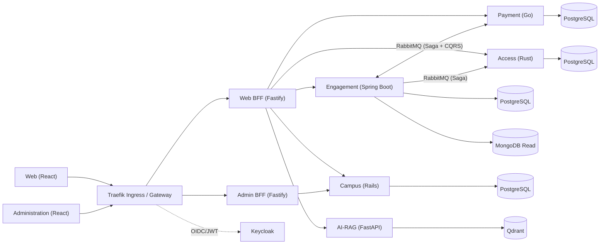
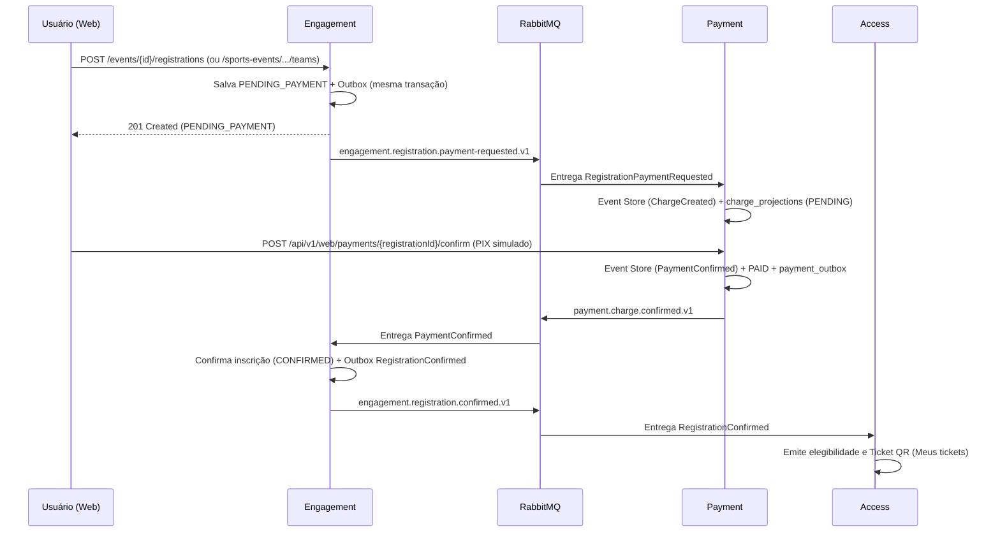
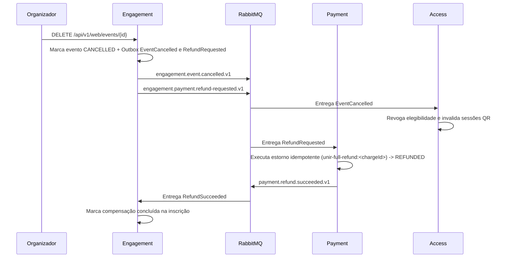

# Relatório Técnico — UNIR (GCC129: Sistemas Distribuídos)

**Projeto:** UNIR — *University Network for Integration and Relationships*  
**Disciplina:** GCC129 — Sistemas Distribuídos (Universidade Federal de Lavras — UFLA)  
**Modalidade:** Regime Diferencial (entrega unificada: sistema funcional ao vivo + relatório técnico, sem módulo de blockchain conforme registrado no RD Form).

---

## 1. Concepção, Problema e Impacto Social (Parte 1)

### 1.1 Problema e Motivação

A vida acadêmica nas universidades públicas brasileiras é composta por dezenas de atores autônomos — reitoria, unidades acadêmicas, departamentos, diretórios, atléticas, ligas, projetos de extensão e grupos de pesquisa — que hoje divulgam eventos, bolsas, estágios e competições em canais fragmentados (listas de e-mail, murais físicos, redes sociais genéricas e formulários isolados). Essa fragmentação produz assimetria de informação, baixa adesão estudantil e perda de oportunidades críticas de permanência.

A motivação fundamenta-se em cinco referências institucionais e científicas:

1. **INEP / MEC (2023) — *Censo da Educação Superior*:** aponta taxas acumuladas de desistência superiores a 50% nos cursos de graduação presenciais brasileiros, especialmente nos primeiros períodos, correlacionadas à baixa integração do discente ao ambiente universitário.
2. **Tinto, V. (1993) — *Leaving College: Rethinking the Causes and Cures of Student Attrition* (University of Chicago Press):** estabelece que a permanência universitária depende diretamente da integração acadêmica e social do estudante com docentes, departamentos e comunidades estudantis.
3. **Pascarella, E. T., & Terenzini, P. T. (2005) — *How College Affects Students* (Jossey-Bass):** sintetiza evidências empíricas de que a participação em atividades extracurriculares, pesquisa e esporte universitário fortalece o desempenho acadêmico e o pertencimento institucional.
4. **FONAPRACE / ANDIFES (2019) — *V Pesquisa Nacional de Perfil Socioeconômico e Cultural dos(as) Graduandos(as) das IFES*:** identifica que estudantes ingressantes e em vulnerabilidade socioeconômica têm maior dificuldade em localizar editais, bolsas e atividades de integração.
5. **UNESCO (2022) — *Reimagining Our Futures Together: A New Social Contract for Education*:** destaca a importância de ecossistemas digitais abertos e estruturados para democratizar o acesso a oportunidades educacionais.

### 1.2 Impacto Social Esperado e Métricas

A **UNIR** centraliza perfis institucionais, eventos, oportunidades, ligas esportivas, pagamentos e credenciais de presença em uma única plataforma universitária, complementada por descoberta em linguagem natural (RAG). Os beneficiários diretos são estudantes (descoberta igualitária e inscrição unificada), entidades/departamentos (gestão auditável e check-in) e a administração universitária (governança de solicitações). O impacto pode ser medido por:
- **Engajamento discente:** número médio de inscrições em eventos, oportunidades e esportes por semestre;
- **Tempo de descoberta:** redução do tempo para localizar editais/eventos aderentes usando busca semântica/RAG;
- **Efetividade de presença:** relação entre inscritos e check-ins validados via QR Code.

---

## 2. Arquitetura Distribuída (Parte 2)

### 2.1 Decomposição em Microsserviços e Fronteiras de Domínio

A UNIR adota uma arquitetura poliglota com **4 microsserviços de domínio independentes** (além de um serviço especializado de **IA/RAG**, **2 BFFs** e um **API Gateway**), cada qual com banco de dados isolado:

| Serviço | Stack | Banco próprio | Responsabilidade e Fronteira |
| --- | --- | --- | --- |
| **Campus** | Ruby on Rails | PostgreSQL (`unir_campus`) | Estrutura universitária (universidade, unidades, departamentos, cursos, entidades, comunidades), perfis, feed social, solicitações institucionais e autorização contextual. |
| **Engagement** | Java 21 / Spring Boot | PostgreSQL (`unir_engagement`) + MongoDB (`unir_engagement_read`) | Eventos (CQRS + HATEOAS), inscrições, oportunidades e esportes universitários (modalidades, campeonatos, temporadas, equipes, free agents, partidas e presença). |
| **Payment** | Go 1.27 | PostgreSQL (`unir_payment`) | Ciclo de vida financeiro com Event Sourcing (`payment_events`), projeções (`charge_projections`), PIX simulado e estornos compensatórios. |
| **Access** | Rust / Axum | PostgreSQL (`unir_access`) | Emissão de tickets/credenciais QR, validação de presença e revogação de acesso quando um evento é cancelado. |
| **AI-RAG** | Python / FastAPI | Qdrant (`unir_knowledge`) | Ingestão, embeddings locais (FastEmbed), recuperação vetorial, LangChain + tool de consulta ao vivo e geração via Gemini com resiliência. |

**Justificativa das fronteiras:** separar *Campus* (dados estruturais e grafo social, majoritariamente leitura e governança) de *Engagement* (alta concorrência de inscrições e esportes), *Payment* (integridade financeira e trilha de auditoria append-only) e *Access* (baixa latência na portaria/QR) permite evolução, linguagens e escalabilidade independentes sem acoplamento de schema.

### 2.2 API REST, Versionamento, OpenAPI e HATEOAS

- **Versionamento:** estratégia por prefixo de URI (`/api/v1`), escolhida pela clareza operacional no roteamento do Gateway, facilidade de cache/observabilidade e convivência controlada em evoluções incompatíveis.
- **Contrato OpenAPI 3.0.3:** documentado em [`docs/api/openapi.yaml`](api/openapi.yaml), cobrindo recursos, verbos HTTP (`GET`, `POST`, `PATCH`, `DELETE`), códigos de status (`200`, `201`, `400`, `401`, `403`, `404`, `409`, `503`) e esquema de segurança Bearer JWT.
- **HATEOAS:** implementado no recurso `EventResponse` (`engagement/src/main/java/br/unir/engagement/dto/EventResponse.java`, testado em `EventResponseHateoasTest`). Cada evento expõe `_links` contextuais conforme seu estado:
  - Evento `ACTIVE`: `self`, `collection`, `update`, `cancel`, `register` (quando interno) e `attendanceQr` (quando `attendanceEnabled = true`).
  - Evento `CANCELLED`: omite transições inválidas, retornando apenas `self` e `collection`.

### 2.3 API Gateway e Dois BFFs Distintos

O **API Gateway** (`gateway`, Spring Cloud Gateway MVC) centraliza:
- Validação criptográfica de JWT (assinatura JWKS e *issuer* do Keycloak) e controle de papéis globais (`USER`, `PLATFORM_ADMIN`);
- Política de CORS diferenciada por origem (`web` vs `admin-web`);
- Roteamento explícito por rota e método HTTP (negação por padrão via `anyRequest().denyAll()`).

Os **dois BFFs** justificam-se pelas necessidades distintas dos clientes:
- **`web-bff` (`/api/v1/web/*`):** atende estudantes, professores e organizadores; compõe dados de múltiplos serviços (ex.: `GET /api/v1/web/me/tickets` agrega inscrições do *Engagement* com tickets QR do *Access*) e encaminha operações de feed, eventos, esportes, pagamentos e RAG.
- **`admin-bff` (`/api/v1/admin/*`):** restrito a `PLATFORM_ADMIN`; expõe `GET /api/v1/admin/overview`, que agrega em **uma única chamada** o perfil do administrador, dados da universidade, contadores de unidades/departamentos/entidades/comunidades e a fila de solicitações pendentes, além das ações `POST /api/v1/admin/requests/{id}/approve|reject`.

### 2.4 Database per Service, Consistência Eventual e Outbox

Cada serviço possui instância PostgreSQL própria (sem foreign keys ou acesso cruzado entre bancos). Para eliminar o risco de **dual write** (gravar no banco local e falhar ao publicar no RabbitMQ), tanto o **Engagement** (`outbox_events`) quanto o **Payment** (`payment_outbox`) gravam a alteração de estado e o evento de integração na **mesma transação ACID**; publicadores em background encaminham ao RabbitMQ com *publisher confirms* e retry, enquanto consumidores garantem idempotência por `message_id` (`processed_messages` / `processed_payment_confirmations`).

### 2.5 SAGA Coreografada (3 Serviços + Compensação)

**Escolha:** **Saga Coreografada** via RabbitMQ (`unir.events`), em vez de orquestrada.  
**Justificativa:** os fluxos de inscrição paga (eventos e esportes) e cancelamento possuem passos bem definidos e desacoplados entre 3 serviços (*Engagement*, *Payment*, *Access*). A coreografia evita um ponto único de acoplamento central (orquestrador) e aproveita o padrão Outbox + Event Sourcing já presente no *Payment*, mantendo cada domínio autônomo sobre seu estado.

#### Caminho Feliz (Inscrição Paga → Pagamento → Ticket / Esporte Confirmado)

#### Cenário de Falha e Compensação (Cancelamento de Evento Pago)

### 2.6 CQRS no Engagement

O serviço **Engagement** separa o modelo de escrita de eventos (**PostgreSQL**, normalizado, com locks pessimistas para controle de capacidade e transações da Outbox) do modelo de leitura (**MongoDB**, coleção `event_views`, otimizado para consultas paginadas e filtros rápidos).

- **Atualização:** toda criação/atualização/cancelamento de evento grava `EventProjectionOutbox` na mesma transação do PostgreSQL; o `EventProjectionConsumer` consome do RabbitMQ e aplica upsert versionado (`aggregateVersion`) no MongoDB.
- **Defasagem aceitável:** consistência eventual próxima do intervalo de polling da Outbox (`OUTBOX_POLL_INTERVAL_MS=1000 ms`); em execução ao vivo no cluster Kubernetes local via `scripts/demo-saga-compensation.sh`, a defasagem medida entre a escrita no PostgreSQL e a disponibilidade da leitura no MongoDB foi de **1.097 ms** (aceitável para listagem de eventos universitários).

---

## 3. Containerização e Orquestração (Parte 3)

- **Dockerfiles próprios e multi-stage:** todos os serviços (`campus`, `engagement`, `payment`, `access`, `gateway`, `web-bff`, `admin-bff`, `web`, `admin-web`, `ai-rag`, `keycloak-theme`) possuem `Dockerfile` dedicado. Os serviços compilados (Java/Maven, Go, Rust) utilizam *multi-stage build*, separando imagem de compilação da imagem runtime enxuta (reduzindo tamanho de imagem e superfície de ataque).
- **Docker Compose:** `compose.yaml` sobe toda a stack com redes isoladas, volumes nomeados por banco e reset determinístico em um único comando (`make local-reset`).
- **Kubernetes (`infra/k8s/` + `scripts/k8s-up.sh`):**
  - `Deployments` com réplicas explícitas e sondas `readinessProbe` / `livenessProbe` para todos os serviços stateless;
  - `StatefulSets` / PVCs dedicados para os 4 PostgreSQL, MongoDB, RabbitMQ e Qdrant;
  - `Services` ClusterIP internos (bancos e broker não expostos externamente);
  - `Traefik Ingress` (`infra/k8s/09-ingress.yaml`) roteando `http://localhost:18080` (Web + Gateway + Keycloak) e `http://admin.localhost:18080` (Administration);
  - `ConfigMaps` e `Secrets` externalizados (nenhuma credencial hardcoded em código-fonte);
  - **Escalabilidade real:** `scripts/k8s-scale-demo.sh` escala o serviço alvo para **3 réplicas** e comprova a distribuição de requisições entre os pods distintos.

---

## 4. Sistema em Funcionamento e Integração de IA/RAG (Parte 4)

### 4.1 Pipeline RAG e LangChain (`ai-rag`)

- **Base de conhecimento:** eventos e oportunidades reais do *Engagement* (ingeridos via API HTTP autenticada, sem acesso direto ao banco SQL).
- **Embeddings e Armazenamento Vetorial:** `FastEmbed` local (`sentence-transformers/paraphrase-multilingual-MiniLM-L12-v2`, suporte a português, custo zero de API) persistido no **Qdrant** com reindexação idempotente.
- **LangChain:** composição via chains (`LCEL`) combinando recuperador vetorial, prompt fundamentado com citações obrigatórias e uma **tool integrada** (`use_live_tool: true`) que consulta dados em tempo real no *Engagement* para responder sobre disponibilidade e prazos atuais.

### 4.2 Resiliência, Avaliação, Latência e Custo

O provedor remoto (**Gemini**) é tratado como dependência falível com **3 mecanismos**:
1. **Timeout e Retry com backoff exponencial** nas chamadas ao LLM;
2. **Circuit Breaker** para interromper tentativas consecutivas em falhas repetidas;
3. **Fallback determinístico** baseado nos trechos recuperados do Qdrant quando o LLM está indisponível ou sem `GEMINI_API_KEY`.

**Avaliação comparativa (5 perguntas com vs. sem recuperação):** o módulo `ai-rag` inclui suite de benchmark (`POST /api/v1/rag/evaluate`) avaliando 5 perguntas reais do domínio (eventos de tecnologia, oportunidades de desenvolvimento, atividades gratuitas, prazos específicos e interesses). Sem recuperação, o modelo não possui acesso aos registros internos da UFLA e tende a respostas genéricas; com RAG + tool ao vivo, as respostas citam títulos, datas e IDs reais persistidos.

**Latência e estimativa de custo em escala:**
- Embeddings locais (FastEmbed + Qdrant): latência típica de ~40–120 ms por consulta, custo de API \$0,00.
- Geração remota (Gemini 2.5 Flash): latência típica de ~800–2.000 ms; assumindo ~1.200 tokens de entrada (contexto recuperado + prompt) e ~300 tokens de saída por consulta (tabela de referência em `ai-rag/src/unir_rag/config.py`), o custo estimado é da ordem de **\$0,0002 a \$0,0006 por consulta** (cerca de **\$2 a \$6 para 10.000 consultas/mês**), viável para uso universitário em escala.

---

## 5. Roteiro de Demonstração ao Vivo

1. **Reset / Subida limpa:** `make local-reset` (Docker Compose) ou `./scripts/k8s-up.sh` (Kubernetes `kind`).
2. **Painel Admin vs. Web (2 BFFs):** acessar `Administration` com `unir.admin` (ver agregação do `admin-bff` e aprovar/rejeitar solicitação pendente) e `Web` com usuário comum.
3. **Esportes + Pagamentos + Tickets (Saga completa na UI):** criar/inscrever em campeonato ou evento pago → confirmar PIX simulado em **Meus pagamentos** → ver liberação automática em **Meus tickets** ou **Meus esportes**.
4. **Saga com Compensação + CQRS + HATEOAS (CLI reproduzível):** executar `./scripts/demo-saga-compensation.sh` mostrando `_links` HATEOAS, lag do MongoDB em ms, caminho feliz até ticket e cancelamento provocando `REFUNDED` no Payment.
5. **Escalabilidade Kubernetes:** executar `./scripts/k8s-scale-demo.sh` (3 réplicas distribuindo carga).
6. **RAG + LangChain Tool:** consultar via `POST /api/v1/web/rag/query` (com e sem `use_live_tool`) e demonstrar fallback na ausência de chave/falha do provedor.
