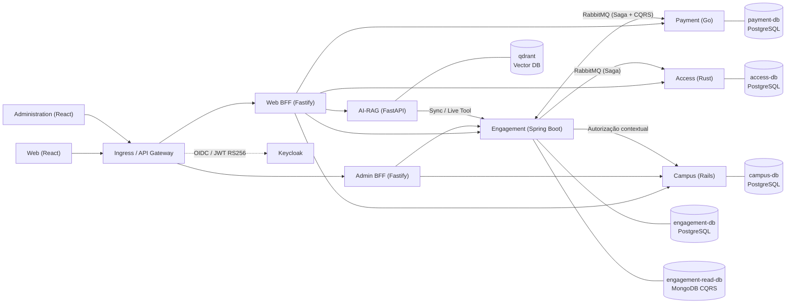
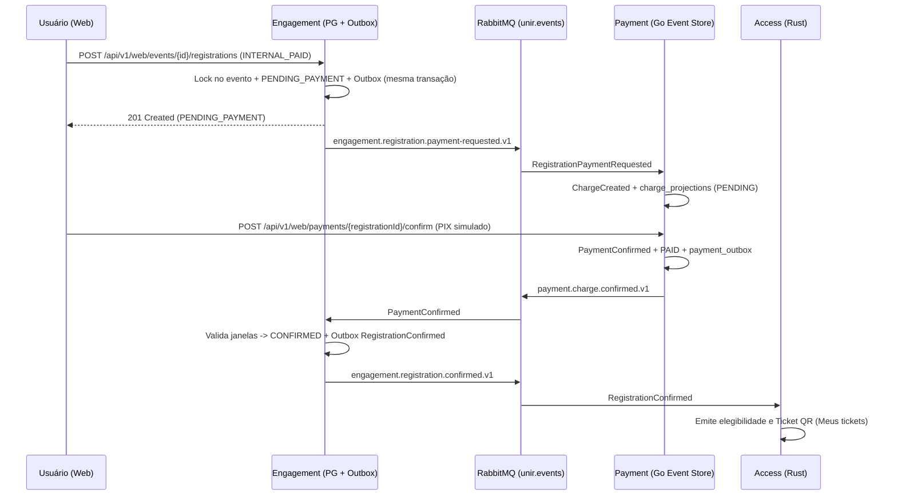
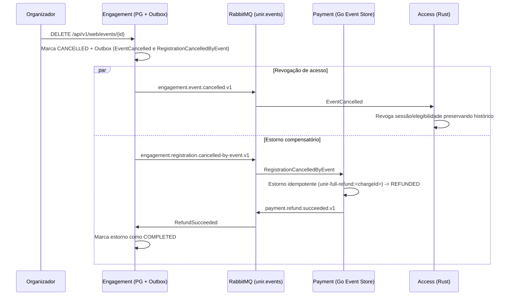

# Relatório Técnico — UNIR (GCC129: Sistemas Distribuídos)

**Startup / Projeto:** UNIR — *University Network for Integration and Relationships*  
**Disciplina:** GCC129 — Sistemas Distribuídos (Universidade Federal de Lavras — UFLA)  
**Autor:** Rafael Silva Martins — Matrícula `202420228`  
**Modalidade:** Regime Diferencial (entrega individual unificada: sistema funcional ao vivo + relatório técnico, sem módulo de blockchain conforme registrado no RD Form).

---

## 1. Concepção, Problema, Fundamentação Científica e Impacto Social

### 1.1 Problema e Motivação

A vivência universitária em instituições públicas brasileiras envolve dezenas de atores autônomos — reitoria, unidades acadêmicas, departamentos, diretórios e centros acadêmicos, ligas estudantis, atléticas, projetos de extensão e grupos de pesquisa — que frequentemente divulgam eventos, bolsas, estágios, conversas comunitárias e competições esportivas em canais fragmentados (murais físicos, listas de e-mail, grupos fechados em redes sociais genéricas e formulários isolados). Essa dispersão gera assimetria de informação, dificulta a participação de estudantes ingressantes e enfraquece o **senso de pertencimento universitário** (*sense of belonging*), um dos fatores mais determinantes para o engajamento e a permanência no ensino superior.

A motivação do projeto fundamenta-se em seis referências científicas e institucionais:

1. **Strayhorn, T. L. (2018) — *College Students' Sense of Belonging: A Key to Educational Success for All Students* (2ª ed., Routledge):** demonstra que o senso de pertencimento é uma necessidade psicológica fundamental no ensino superior e um preditor direto de sucesso acadêmico, engajamento e permanência, sendo fortemente impulsionado pela participação ativa em comunidades, eventos e espaços institucionais do campus.
2. **Hausmann, L. R. M., Schofield, J. W., & Woods, R. L. (2007) — *"Sense of Belonging as a Predictor of Intentions to Persist Among African American and White First-Year College Students"*, *Research in Higher Education*, 48(7), 803–839 (DOI: `10.1007/s11162-007-9052-9`):** estudo longitudinal que comprova que o senso de pertencimento do estudante à universidade prediz estatisticamente sua intenção de permanência no curso, mesmo após controlar variáveis socioeconômicas e de desempenho prévio, além de mostrar que intervenções voltadas ao fortalecimento desse vínculo reduzem o declínio natural de pertencimento no primeiro ano.
3. **Tinto, V. (1993) — *Leaving College: Rethinking the Causes and Cures of Student Attrition* (2ª ed., University of Chicago Press):** modelo clássico de permanência universitária que estabelece que a evasão decorre em grande medida da falha de integração acadêmica e social do discente com docentes, departamentos e comunidades estudantis.
4. **Astin, A. W. (1984; reimpresso em 1999) — *"Student Involvement: A Developmental Theory for Higher Education"*, *Journal of College Student Development*, 40(5), 518–529:** propõe a Teoria do Envolvimento Estudantil, demonstrando que o aprendizado, o desenvolvimento pessoal e a retenção crescem proporcionalmente à energia física e psicológica investida pelo estudante na vida do campus (eventos, grupos, esportes e iniciação científica).
5. **INEP / MEC (2023) — *Censo da Educação Superior*:** registra taxas acumuladas de desistência superiores a 50% nos cursos de graduação presenciais brasileiros, com maior incidência nos períodos iniciais, reforçando a urgência de ferramentas que acelerem a integração do ingressante ao ecossistema acadêmico.
6. **FONAPRACE / ANDIFES (2019) — *V Pesquisa Nacional de Perfil Socioeconômico e Cultural dos(as) Graduandos(as) das IFES*:** evidencia que estudantes ingressantes e em vulnerabilidade socioeconômica enfrentam barreiras adicionais de acesso à informação sobre editais, bolsas, auxílios e atividades extracurriculares.

### 1.2 Impacto Social Esperado e Métricas

A **UNIR** fortalece o **senso de pertencimento universitário** ao centralizar, em uma única plataforma aberta e estruturada, o mapa institucional (universidade, unidades, departamentos, cursos, entidades e comunidades), o feed acadêmico por semestre, eventos, oportunidades (bolsas/estágios/pesquisa), campeonatos esportivos, pagamentos simulados, tickets com QR Code e descoberta em linguagem natural (RAG).

- **Beneficiários diretos:** estudantes (descoberta igualitária de oportunidades e maior integração social desde o primeiro período), docentes e entidades estudantis (gestão unificada de eventos, presença auditável e divulgação segmentada) e gestão universitária (governança transparente de perfis e aprovações).
- **Indicadores mensuráveis de impacto:**
  1. **Taxa de participação discente:** número médio de inscrições em eventos, oportunidades e competições esportivas por estudante/semestre;
  2. **Engajamento comunitário:** proporção de estudantes seguindo departamentos, entidades ou comunidades e participando de enquetes/conversas;
  3. **Efetividade de presença:** relação entre inscritos e check-ins validados por QR Code;
  4. **Tempo de descoberta:** tempo necessário para localizar um edital ou evento aderente usando o Assistente UNIR (RAG).

---

## 2. Arquitetura Distribuída

### 2.1 Decomposição em Microsserviços e Fronteiras de Domínio

A UNIR implementa uma arquitetura poliglota com **4 microsserviços de domínio independentes**, **1 serviço especializado de IA/RAG**, **2 BFFs** (*Backend for Frontend*), **1 API Gateway**, **1 provedor de identidade (Keycloak)** e **2 clientes web distintos** (`web` e `admin-web`).

| Serviço | Linguagem / Stack | Banco de dados exclusivo | Responsabilidade e Fronteira |
| --- | --- | --- | --- |
| **Campus** | Ruby 3.4 / Rails 8 | PostgreSQL (`unir_campus`) | Estrutura institucional (universidade, unidades, departamentos, cursos, semestres, entidades, comunidades), perfis de usuários, solicitações de verificação/criação, feed/enquetes, notificações e **autorização contextual**. |
| **Engagement** | Java 21 / Spring Boot | PostgreSQL (`unir_engagement`) + MongoDB (`unir_engagement_read`) | Eventos (escrita transacional + CQRS + HATEOAS), inscrições, oportunidades, esportes universitários (modalidades, campeonatos, temporadas, equipes com código 24h, *free agents*, partidas, mata-mata e presença) e Outbox transacional. |
| **Payment** | Go 1.27 | PostgreSQL (`unir_payment`) | Ciclo de vida financeiro com Event Sourcing (`payment_events`), projeções (`charge_projections`), PIX simulado (`SimulatedPixProvider`, sem dinheiro real), estornos compensatórios (`REFUNDED`) e Outbox própria (`payment_outbox`). |
| **Access** | Rust 1.94 / Axum | PostgreSQL (`unir_access`) | Credenciamento de eventos, emissão de tickets e tokens QR com hash, check-in/lista de presença (`ATTENDED` / `NO_SHOW`) e revogação de elegibilidade em cancelamentos. |
| **AI-RAG** | Python 3.12 / FastAPI + LangChain | Qdrant (`unir_knowledge`) | Ingestão via HTTP autenticado, geração de embeddings locais (FastEmbed ONNX), busca vetorial, chain LangChain com *tool* ao vivo e geração via Gemini com resiliência e telemetria. |

**Justificativa das fronteiras:** separar **Campus** (dados estruturais, governança e grafo social), **Engagement** (alta concorrência na reserva de vagas e gestão esportiva), **Payment** (integridade financeira e trilha imutável *append-only* de eventos) e **Access** (validação rápida de QR Code em portaria) garante autonomia de dados, escolha de linguagem aderente a cada carga e isolamento de falhas — por exemplo, uma indisponibilidade do `ai-rag` ou do `access` não interrompe o cadastro acadêmico no `campus` nem a criação de cobranças no `payment`.



### 2.2 API REST, Versionamento, OpenAPI e HATEOAS

- **Versionamento:** prefixo explícito na URI (`/api/v1`), escolhido pela clareza no roteamento do API Gateway, facilidade de observabilidade/cache e possibilidade de coexistência controlada em evoluções incompatíveis.
- **Contrato OpenAPI 3.0.3:** especificado em [`docs/api/openapi.yaml`](api/openapi.yaml) e detalhado por domínio em [`docs/contracts/`](contracts/), empregando recursos substantivos, verbos HTTP semânticos (`GET`, `POST`, `PATCH`, `DELETE`), *Problem Details* (`RFC 9457`) e códigos de status consistentes (`200`, `201`, `400`, `401`, `403`, `404`, `409`, `422`, `503`).
- **HATEOAS:** implementado em `EventResponse` (`engagement/src/main/java/br/unir/engagement/dto/EventResponse.java`, coberto por `EventResponseHateoasTest`). Os links `_links` são computados dinamicamente segundo o estado do recurso e a permissão do usuário:
  - **Evento `ACTIVE` (visão de organizador):** expõe `self`, `collection`, `register`, `update` e `cancel`:
    ```json
    "_links": {
      "self":       { "href": "/api/v1/web/events/{id}",               "method": "GET" },
      "collection": { "href": "/api/v1/web/events",                    "method": "GET" },
      "register":   { "href": "/api/v1/web/events/{id}/registrations", "method": "POST" },
      "update":     { "href": "/api/v1/web/events/{id}",               "method": "PATCH" },
      "cancel":     { "href": "/api/v1/web/events/{id}",               "method": "DELETE" }
    }
    ```
  - **Evento `ACTIVE` (visão de estudante comum):** omite `update` e `cancel`, expondo apenas `self`, `collection` e `register`.
  - **Evento `CANCELLED`:** omite todas as transições inválidas (`register`, `update`, `cancel`), retornando apenas `self` e `collection`.

### 2.3 API Gateway e Dois BFFs Distintos

O **API Gateway** (`gateway`, Spring Cloud Gateway MVC) centraliza:
- Validação criptográfica de JWT (chaves JWKS e *issuer* do Keycloak) e controle de papéis globais (`USER`, `PLATFORM_ADMIN`);
- Política de CORS segmentada por origem (`web` vs. `admin-web`);
- Roteamento explícito por prefixo (`/api/v1/web/**` → `web-bff`, `/api/v1/admin/**` → `admin-bff`) com negação padrão (`anyRequest().denyAll()`).

Os **dois BFFs** (`web-bff` e `admin-bff`, ambos sem estado e sem banco próprio) existem porque os dois clientes possuem perfis de consumo e segurança completamente diferentes:

| Aspecto | `web-bff` (`/api/v1/web/*`) | `admin-bff` (`/api/v1/admin/*`) |
| --- | --- | --- |
| **Público e papel** | Estudantes, professores e organizadores (`USER` ou `PLATFORM_ADMIN`) | Exclusivo de administradores globais (`PLATFORM_ADMIN`) |
| **Serviços agregados** | `campus`, `engagement`, `payment`, `access` e `ai-rag` | `campus` e `engagement` |
| **Adaptação de resposta** | Enriquece `GET /api/v1/web/me/tickets` (juntando inscrições do `engagement` + tickets QR do `access`), `GET /api/v1/web/payments/me` (enriquecendo cobranças do `payment` com `title`, `subtitle` e `targetPath` do `engagement`) e injeta `viewerCanManage` / `_links` de eventos | Agrega em **uma única chamada** (`GET /api/v1/admin/overview`) universidade, unidades, departamentos, entidades, comunidades, cursos, semestres, usuários e fila de solicitações pendentes, expondo controles administrativos (`viewerCanManage`, `protectedAdministratorUserId`) |

**Exemplo real comparando as respostas servidas a cada cliente:**
- **Resposta do `web-bff` (`GET /api/v1/web/events?page=0&size=1` para `aluno1@gmail.com`):** orientada à descoberta e ação do estudante, contendo `viewerCanManage: false`, `registrationBlockedReason` e `_links` apenas de leitura/inscrição (`self`, `collection`, `register`).
- **Resposta do `admin-bff` (`GET /api/v1/admin/overview` para `admin@gmail.com`):** orientada à governança consolidada, retornando em um único JSON estruturado as seções `university`, `academicUnits`, `departments`, `entities`, `communities`, `semesters`, `pendingRequests` e `users` com `protectedAdministratorUserId` e permissões administrativas.

### 2.4 Database per Service, Consistência Eventual, Dual Write e Outbox

- **Isolamento estrito:** nenhum serviço acessa o banco de outro; identificadores cruzados (`userId` = `sub` do Keycloak, `departmentId`, `eventId`, `registrationId`) são referências lógicas sem *foreign keys* entre bancos.
- **Tecnologia poliglota justificada:**
  - **PostgreSQL** (`campus`, `engagement`, `payment`, `access`): transações ACID, locks pessimistas (`SELECT FOR UPDATE` na capacidade de eventos), índices únicos parciais e *constraints* relacionais.
  - **MongoDB** (`engagement-read-db`): documentos desnormalizados (`event_views`) otimizados para filtragem e paginação rápida na vitrine pública de eventos (CQRS).
  - **Qdrant** (`ai-rag`): índice vetorial HNSW nativo para busca por similaridade de cosseno nos embeddings de 384 dimensões.
- **Pontos de consistência eventual identificados:** (1) projeção de eventos do PostgreSQL para o MongoDB (`event_views`); (2) propagação de inscrições pagas entre `Engagement → Payment → Access`; (3) propagação de cancelamentos e estornos compensatórios; (4) reindexação do catálogo de eventos/oportunidades no Qdrant.
- **Análise do risco de *dual write* e padrão Transactional Outbox:** se o `Engagement` gravasse uma inscrição no PostgreSQL e publicasse diretamente no RabbitMQ em uma chamada de rede separada, uma falha entre os dois passos deixaria cobranças órfãs ou inscrições travadas em `PENDING_PAYMENT`. Para eliminar o *dual write*, tanto o **Engagement** (`outbox_events`) quanto o **Payment** (`payment_outbox`) gravam a mudança de estado e a mensagem de integração **na mesma transação PostgreSQL**. Publicadores em background leem registros não publicados e só marcam `published_at` após receber *publisher confirm* roteado do RabbitMQ; todos os consumidores mantêm tabelas de deduplicação por `message_id` (`processed_messages`, `processed_payment_confirmations`, `processed_refund_results`) e só enviam `ACK` manual após commit local.

### 2.5 SAGA Coreografada (3 Serviços e Compensações)

- **Variante escolhida:** **Saga Coreografada** sobre RabbitMQ (exchange `unir.events`), em vez de orquestrada.
- **Justificativa:** os fluxos de inscrição paga e cancelamento envolvem 3 domínios bem delimitados (**Engagement**, **Payment**, **Access**) com reações claras a eventos de domínio. A coreografia evita um serviço orquestrador central acoplado às regras de todos os domínios e se integra naturalmente ao *Transactional Outbox* e ao *Event Sourcing* já presentes no `Payment`.
- **Compensações definidas:**
  1. **Cancelamento institucional de evento ou campeonato (`DELETE /events/{id}` ou `POST /sports-events/.../cancel`):** `Engagement` marca o evento/inscrições como `CANCELLED`, grava `EventCancelled` (para o `Access` revogar elegibilidade preservando histórico) e `RegistrationCancelledByEvent` (para o `Payment` cancelar cobrança `PENDING` ou estornar integralmente cobrança `PAID` → `REFUNDED`, emitindo `RefundSucceeded`).
  2. **Pagamento tardio ou reserva expirada:** se `PaymentConfirmed` chega após `paymentDeadlineAt` ou `reservationExpiresAt`, `Engagement` não reativa a inscrição, registra um `payment_compensation_cases` e grava `RefundRequested` na Outbox, disparando o estorno idempotente (`unir-full-refund:<chargeId>`) no `Payment`.

#### Diagrama de Sequência — Caminho Feliz (3 serviços)



#### Diagrama de Sequência — Falha / Cancelamento com Compensação



### 2.6 CQRS no Engagement

- **Separação de modelos:** o **modelo de escrita** de eventos reside no **PostgreSQL** (`events`, com integridade transacional, locks para controle de capacidade e Outbox), enquanto o **modelo de leitura** público reside no **MongoDB** (coleção `event_views`, com índices de filtro por categoria, modalidade, status e ordenação por data).
- **Justificativa:** a vitrine pública de eventos sofre proporção muito maior de leituras filtradas e paginadas do que de escritas administrativas; isolar a leitura no MongoDB evita contenção com transações críticas de inscrição e pagamento no PostgreSQL.
- **Atualização e defasagem aceitável:** cada mutação de evento grava `EventProjectionOutbox` na mesma transação SQL; o `EventProjectionConsumer` consome do RabbitMQ e aplica *upsert* idempotente validando `aggregateVersion`. A defasagem aceitável para listagem de eventos universitários é da ordem de poucos segundos (`OUTBOX_POLL_INTERVAL_MS=1000 ms`). Em medição ao vivo via `make demo-saga`, a defasagem observada entre a escrita no PostgreSQL e a visibilidade no MongoDB foi de **891 ms**.

---

## 3. Containerização e Orquestração

### 3.1 Docker e Docker Compose

- **Dockerfiles próprios:** todos os 11 componentes (`campus`, `engagement`, `payment`, `access`, `ai-rag`, `gateway`, `web-bff`, `admin-bff`, `web`, `admin-web` e `keycloak-theme`) possuem `Dockerfile` dedicado no repositório.
- **Multi-stage build e ganho medido:** todos os serviços compilados separam o estágio de compilação (*toolchain*) da imagem final de execução, removendo compiladores, SDKs e código-fonte do runtime (menor tamanho, menor tempo de transferência e menor superfície de ataque):

| Serviço | Imagem de build | Imagem runtime final | Redução aproximada |
| --- | --- | --- | --- |
| **`access` (Rust)** | `rust:1.94.0-bookworm` (~2,42 GB) | `unir-access:local` (**169 MB**, `debian:bookworm-slim`) | **~93%** |
| **`payment` (Go)** | `golang:1.27-bookworm` (~900 MB) | `unir-payment:local` (**155 MB**, `debian:bookworm-slim`) | **~83%** |
| **`gateway` (Java)** | `maven:3.9.11-eclipse-temurin-21` (**833 MB**) | `unir-gateway:local` (**543 MB**, `eclipse-temurin:21-jre`) | **~35%** |
| **`engagement` (Java)** | `maven:3.9.11-eclipse-temurin-21` (**833 MB**) | `unir-engagement:local` (**615 MB**, `eclipse-temurin:21-jre`) | **~26%** |
| **`keycloak-theme`** | `node:22` + Maven + JDK para gerar o `.jar` | `unir-keycloak:local` (**755 MB**, apenas +5 MB sobre `keycloak:26.8.0`) | Sem Node/Maven no runtime |

- **Volumes e isolamento de redes no [`compose.yaml`](../compose.yaml):**
  - **9 volumes nomeados** garantem persistência independente (`campus_data`, `engagement_data`, `payment_data`, `access_data`, `keycloak_db_data`, `mongodb_data`, `rabbitmq_data`, `qdrant_rag_data`, `ai_rag_model_cache`).
  - **3 redes isoladas por camada:**
    - `edge`: apenas `web`, `admin-web`, `gateway` e `keycloak` (os frontends não enxergam os bancos nem o RabbitMQ);
    - `internal`: comunicação interna entre `gateway`, `web-bff`, `admin-bff`, serviços de domínio (`campus`, `engagement`, `payment`, `access`, `ai-rag`) e `keycloak`;
    - `data`: exclusivamente os bancos de dados, `rabbitmq`, `mailpit` e `qdrant`, acessíveis somente pelos respectivos serviços donos (nem `gateway`, nem BFFs, nem frontends participam da rede `data`).
- **Comando único de subida:** `make docker-demo` (ou `make docker-reset-demo` para zerar volumes e subir do zero) levanta todos os 21 serviços, executa migrations, provisiona contas/realm e popula os dados de demonstração.

### 3.2 Kubernetes (`infra/k8s/`, opção complementar no repositório)

Mantém-se também a infraestrutura completa em Kubernetes local (`kind`) via `make k8s-demo` / `make k8s-reset-demo`:
- `Deployments` com réplicas explícitas e sondas `readinessProbe` / `livenessProbe`;
- `PersistentVolumeClaims` individuais para os bancos PostgreSQL, MongoDB, RabbitMQ e Qdrant (`infra/k8s/03-databases.yaml` e `infra/k8s/10-ai-rag.yaml`);
- `Services` ClusterIP internos e `Traefik Ingress` (`infra/k8s/09-ingress.yaml`) roteando `http://localhost:18080` e `http://admin.localhost:18080`;
- `ConfigMaps` (`01-configmaps.yaml`) e `Secrets` externalizados (modelo em `02-secrets.example.yaml`, gerados em tempo de deploy pelo script a partir de `.env` sem credenciais hardcoded em código);
- Script reproduzível de escalabilidade (`make k8s-scale-demo`), escalando `web-bff` de `1 → 3 → 1` réplicas e comprovando distribuição de requisições nos logs dos pods.

---

## 4. Sistema em Funcionamento e Integração de IA / RAG

### 4.1 Pipeline RAG e LangChain (`ai-rag`)

- **Base de conhecimento própria:** catálogo real de eventos e oportunidades do serviço `Engagement`, ingerido via API HTTP autenticada (client credentials OIDC `unir-rag-sync`), respeitando o isolamento *Database per Service*.
- **Pipeline completo:** ingestão paginada → criação de documentos estruturados (`langchain_core.documents.Document`) → geração de embeddings locais via **FastEmbed ONNX** (`sentence-transformers/paraphrase-multilingual-MiniLM-L12-v2`, 384 dimensões, suporte a português, custo de API \$0,00) → armazenamento idempotente por UUID determinístico no **Qdrant** (`unir_knowledge`) → recuperação top-*k* por similaridade → geração fundamentada com citações obrigatórias `[ID: ...]`.
- **LangChain (`chains` + `tool`):** implementado com `RunnableLambda` / LCEL (`ai-rag/src/unir_rag/chain.py`) e uma **`StructuredTool` real** (`search_live_unir_events` em `ai-rag/src/unir_rag/tools.py`) que, quando acionada (`use_live_tool: true`), consulta ao vivo os eventos atuais na API do `Engagement` para complementar o índice vetorial com prazos e disponibilidades em tempo real.

### 4.2 LLM como Serviço Distribuído (Resiliência)

O provedor remoto (**Google Gemini**, padrão `gemini-3.5-flash` configurável por `GEMINI_MODEL`) é tratado explicitamente como dependência remota falível com **2 mecanismos implementados e testados** em `ai-rag/src/unir_rag/chain.py` (sem simulação de mecanismos ausentes):

1. **Timeout + Retry com backoff exponencial:** cada chamada ao Gemini tem limite rígido de tempo (`GEMINI_TIMEOUT_SECONDS=20.0`), com até 2 retentativas (`GEMINI_MAX_RETRIES=2`, total de 3 tentativas) e atraso exponencial (`0,25 s → 0,50 s`) em falhas transitórias (timeout, rede, HTTP `429` ou `5xx`).
2. **Fallback determinístico explícito (`FALLBACK_RETRIEVAL_ONLY`):** caso a chave `GEMINI_API_KEY` não esteja configurada ou as tentativas falhem por indisponibilidade/cota do provedor, o serviço **não quebra com HTTP 500 nem fabrica texto** — devolve resposta degradada transparente listando os documentos reais recuperados do Qdrant (com título, `[ID]`, prazo e rota interna) e sinalizando `fallback_used: true` e `fallback_reason`.

### 4.3 Avaliação Real do RAG (5 Perguntas — Com vs. Sem Recuperação), Latência e Custo

A bateria padronizada de 5 perguntas do domínio (`BENCHMARK_QUESTIONS_V1` em `ai-rag/src/unir_rag/evaluation.py`) foi executada ao vivo contra o serviço `ai-rag` (`POST /api/v1/rag/evaluate`) usando `gemini-3.5-flash` e a base demo indexada no Qdrant:

| ID | Pergunta de teste | Sem recuperação (Baseline) | Com recuperação (RAG — Qdrant + Gemini) | Análise comparativa |
| --- | --- | --- | --- | --- |
| **Q1** | *Quais eventos gratuitos de tecnologia ou software estão disponíveis na UNIR e quais são seus locais?* | `GENERATED` · **16.692 ms** · 0 fontes · **\$0,00074** — **Alucinou a instituição**, confundindo "UNIR" com a Universidade Federal de Rondônia (`sigaa.unir.br`, Porto Velho) sem listar nenhum evento real. | `GENERATED` · **7.686 ms** (118,5 ms busca + 7.567 ms LLM) · 4 fontes / **2 citadas** · **\$0,00098** — Listou corretamente *Oficina de observabilidade para projetos de graduação* (Lab. de Computação 2) e *Mostra de protótipos de automação* (Hall do ICET) com UUIDs reais. | O RAG eliminou a confusão de entidade e entregou dados reais, locais e gratuitos em menos da metade do tempo do baseline. |
| **Q2** | *Existem oportunidades de estágio ou bolsas de iniciação científica em dados e qual é o link externo?* | `GENERATED` · **14.535 ms** · 0 fontes · **\$0,00105** — Admitiu não ter acesso à base nem aos links externos de inscrição. | `FALLBACK_RETRIEVAL_ONLY` (HTTP 429 do provedor) · **1.341 ms** (60,0 ms busca) · **4 fontes reais devolvidas** · **\$0,00** — Mesmo sob limite de cota do Gemini, entregou os registros reais de oportunidades/eventos recuperados do Qdrant. | Evidenciou na prática o valor do fallback com Qdrant local: mesmo com falha externa do LLM, o usuário manteve acesso às fontes reais. |
| **Q3** | *Quais atividades gratuitas de cultura, leitura ou extensão posso encontrar no campus?* | `FALLBACK_RETRIEVAL_ONLY` (HTTP 429) · **1.234 ms** · **0 fontes** · **\$0,00** — Sem contexto local, a indisponibilidade do LLM deixou o usuário sem nenhum registro útil. | `FALLBACK_RETRIEVAL_ONLY` (HTTP 429) · **1.314 ms** (67,1 ms busca) · **4 fontes reais devolvidas** · **\$0,00** — Retornou os eventos/oportunidades reais do campus com aviso explícito de degradação. | Contraste direto sob falha do provedor: sem RAG o resultado é vazio; com RAG o fallback continua útil. |
| **Q4** | *Qual é o prazo de inscrição e o valor da Oficina de prototipação ou de outros eventos pagos internos?* | `GENERATED` · **10.965 ms** · 0 fontes · **\$0,00068** — Resposta genérica sem capacidade de verificar se o evento existe ou não. | `GENERATED` · **9.510 ms** (86,3 ms busca + 9.423 ms LLM) · 4 fontes / **2 citadas** · **\$0,00108** — **Recusou alucinar**, informando que não há *Oficina de prototipação* paga cadastrada no momento e citando os eventos gratuitos vigentes. | Comprovou ancoragem factual (*grounding*): o RAG evita inventar preços e prazos quando o registro não existe na base. |
| **Q5** | *Existem eventos ou atividades de esportes, jogos de tabuleiro ou integração estudantil disponíveis?* | `GENERATED` · **10.161 ms** · 0 fontes · **\$0,00074** — Genérico, sem acesso à agenda atual do campus. | `FALLBACK_RETRIEVAL_ONLY` (HTTP 429) · **1.391 ms** (129,0 ms busca) · **4 fontes reais devolvidas** · **\$0,00** — Devolveu os registros reais indexados após esgotar as retentativas com backoff. | Confirmou previsibilidade de latência (~1,3 s no fallback) e integridade do serviço sob *rate limit* externo. |

- **Latência medida:**
  - **Recuperação vetorial local (FastEmbed + Qdrant):** **60 ms a 131 ms** por consulta (custo de API \$0,00).
  - **Geração remota (`gemini-3.5-flash`):** **7,6 s a 14,8 s** nas chamadas bem-sucedidas (incluindo pensamento/geração do modelo); em falha transitória com 3 tentativas + backoff, degradação controlada em **~1,3 s**.
- **Análise de custo em escala** (tarifa de referência em `ai-rag/src/unir_rag/config.py`: \$0,15 / 1M tokens de entrada e \$0,60 / 1M tokens de saída):
  - **Custo medido nas chamadas RAG bem-sucedidas:** ~1.390–1.585 tokens de entrada e ~1.230–1.454 tokens de saída → **\$0,00098 a \$0,00108 por consulta** (total da bateria de 5 perguntas: **\$0,00207** no RAG vs. **\$0,00322** no baseline).
  - **Projeção em escala universitária:** para **10.000 consultas/mês** (~333 consultas/dia em um campus de médio porte), o custo estimado é de aproximadamente **\$10 a \$11/mês** (e **\$0,00** para embeddings e recuperação no Qdrant), demonstrando viabilidade financeira para adoção institucional.

---

## 5. Roteiro de Demonstração ao Vivo

1. **Subida limpa do zero:**
   - **Docker Compose:** `make docker-reset-demo` (`http://localhost:15173` Web · `http://localhost:15175` Admin · `http://localhost:18084` Gateway)
   - **Kubernetes (`kind`):** `make k8s-reset-demo` (`http://localhost:18080` Web · `http://admin.localhost:18080` Admin)
2. **Dois clientes e dois BFFs:** acessar `Administration` como `admin@gmail.com` (senha `123`) para ver a agregação do `admin-bff` (estrutura institucional, solicitações pendentes e gestão esportiva) e acessar `Web` como `aluno1@gmail.com` ou `professor1@gmail.com` (senha `123`) para ver a composição do `web-bff`.
3. **Fluxo completo na UI (Saga + Pagamentos + Presença):** inscrever-se em evento/campeonato pago → confirmar PIX simulado no modal/página **Meus pagamentos** → conferir liberação automática em **Meus tickets** / **Meus esportes** → abrir o modal unificado de **QR Code + Lista de presença**.
4. **Prova reproduzível de HATEOAS + CQRS + Saga com Compensação:** executar `make demo-saga` (Kubernetes) ou `make docker-demo-saga` (Docker Compose) — exibe os `_links` HATEOAS, mede a defasagem real do MongoDB (~891 ms), conclui o caminho feliz até o ticket no `Access` e cancela o evento comprovando o estorno automático para **`REFUNDED`** no `Payment`.
5. **RAG + LangChain Tool + Fallback:** consultar o **Assistente UNIR** na interface Web com perguntas sobre eventos/oportunidades (ativando a consulta ao vivo) e demonstrar citações `[ID]`, latência e fallback explícito quando o LLM está indisponível.
6. *(Opcional — Kubernetes)* **Escalabilidade:** executar `make k8s-scale-demo` para escalar `web-bff` de `1 → 3 → 1` réplicas e observar a distribuição de requisições entre os pods.
